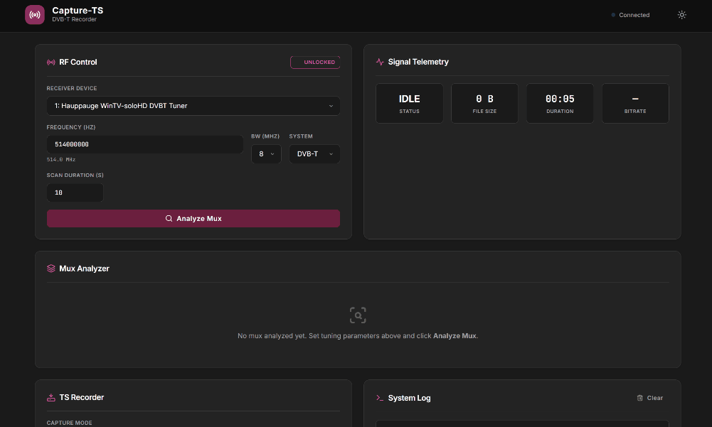
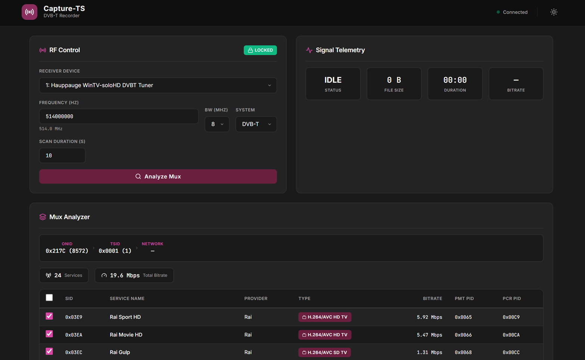
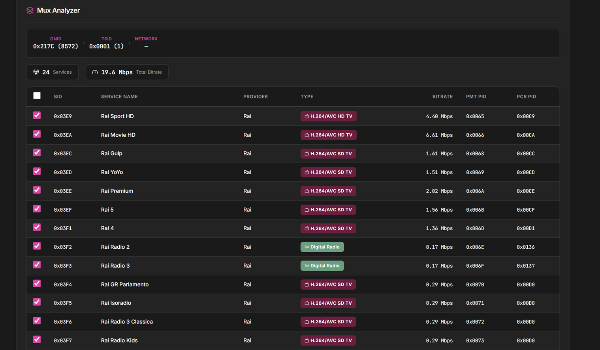
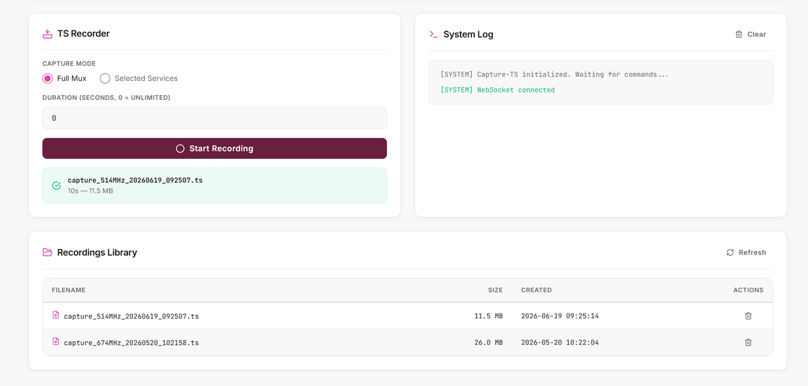
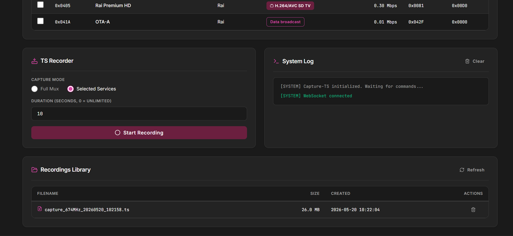

# Capture-TS



Capture-TS is a lightweight web-based DVB-T transport stream capture and recording tool for Windows. It provides a browser dashboard to discover DVB tuner devices, analyze multiplexes using TSDuck, start and stop recordings, and manage your captured `.ts` files — all from a clean, dark-themed UI.

<p align="center">
  
  
</p>
<p align="center">
  
  
</p>

## ✨ Key Features

- **DVB Tuner Discovery** — Automatic detection of connected DVB-T receivers via `tslsdvb`
- **Mux Analysis** — MPEG-2 transport stream multiplex analysis using TSDuck
- **Flexible Recording** — Record a full DVB-T multiplex or only selected services
- **Live Updates** — Real-time recording state and log updates through WebSockets
- **Recording Library** — Browse, playback, and delete captured `.ts` files
- **Dark-Themed UI** — Clean, responsive interface built for quick operation

## 🚀 Getting Started

### Prerequisites

- Windows 10 / 11
- Python 3.10+
- [TSDuck](https://tsduck.io/) — with `tsp`, `tsanalyze`, and `tslsdvb` available in `PATH`
- [Visual Studio Community 2022](https://visualstudio.microsoft.com/) — C++20 support (required by TSDuck)
- USB DVB-T receiver with installed drivers (e.g. Hauppauge WinTV-soloHD)

### Local Installation

1. **Clone the repository**:
   ```bash
   git clone https://github.com/FluxFae/Capture-TS-DVB-T.git
   cd Capture-TS-DVB-T
   ```

2. **Create and activate a virtual environment**:
   ```bash
   python -m venv venv
   venv\Scripts\Activate.ps1   # PowerShell
   # or
   venv\Scripts\activate.bat   # cmd.exe
   ```

3. **Install dependencies**:
   ```bash
   pip install -r requirements.txt
   ```

4. **Run the application**:
   ```bash
   python run.py
   ```

5. Open your browser at `http://127.0.0.1:8000`

## ⚙️ Tech Stack

- **Backend**: Python 3.12, FastAPI, Jinja2
- **Frontend**: HTMX, Lit Web Components, Tailwind CSS
- **DVB Tooling**: TSDuck (`tsp`, `tsanalyze`, `tslsdvb`)

## 🤖 Development & Vibecoding

This project was orchestrated using vibecoding methodologies with AI agents. The development workflow prioritizes rapid problem resolution and iterative AI collaboration over manual implementation.

## 🚧 Project Status (As-Is) & Contributions

This is a personal tool open-sourced for the community. It currently does not have active maintenance or a planned development roadmap.

If you find this tool useful, discover a bug, or want to add an improvement, Pull Requests are welcome. I will review and integrate community contributions based on availability.

## 📜 License

Distributed under the MIT License.
